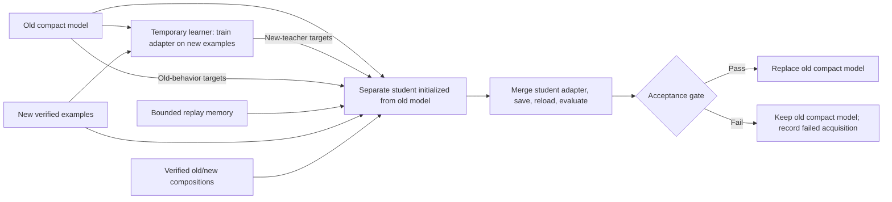

# Temporary learning and compact assimilation: first experiment

Status: completed. The frozen five-stage comparison and artifact audit passed execution checks; no method passed all five learning updates. See the [measured report](results/assimilation/experiment-001/REPORT.md). This remains a candidate learning system, not a proven no-forgetting architecture.

## Architecture and hypothesis

The deployed model is always the same 596,049,920-parameter Qwen3-0.6B checkpoint architecture. At a learning boundary, keep the old model as a temporary reference, train a temporary LoRA learner on the incoming skill, and train a separate compact successor starting from the old model. The learner's weights are not copied into the successor. The successor must acquire the new behavior through consolidation.

Hypothesis: verified old/new composition examples plus old-model behavior preservation improve the acquisition/retention tradeoff beyond bounded replay. A plain-consolidation ablation separates this from merely having a teacher or extra training.



## Steps

1. **Calibrate acquisition using development data.** Repeat the previously weak B/filter and C/sort isolated pilots with 98,304 training tokens. Keep the 75% strict-accuracy threshold and 10-point gain requirement; do not lower the threshold to admit a failing run. If acquisition is still inadequate, retain the failed calibration and revise the budget before freezing final evaluation.
2. **Freeze the comparison.** Pin model revision, generated-data hashes, source snapshots, seed, task order, memory ceilings, phase budgets, and acceptance tolerances before final test scoring. Keep original experiment artifacts intact.
3. **Receive the next skill.** The training worker receives current training examples and the bounded previous memory only. It does not retrieve discarded old datasets or any development/test solutions.
4. **Acquire in temporary capacity.** Freeze the old backbone and train a rank-16 LoRA learner on the incoming skill. Export a temporary teacher, used only during this learning boundary.
5. **Prepare bounded consolidation targets.** Cache old-model distributions on retained old/anchor examples and new-teacher distributions on incoming examples. Use top-k token probabilities plus an explicit residual-probability bin, with a declared cache-byte ceiling. Cache only answer positions, never evaluation prompts. New-teacher distillation is enabled only for examples whose teacher-forced greedy answer tokens all match the verified target. This is a conditional token check, not an independently generated-answer accuracy claim. Supervised targets always come from executable verification.
6. **Train a separate compact successor from the old model.** Use verified new examples, bounded old replay, and optionally verified old/new compositions. Optimize supervised answer loss plus old-behavior KL and eligible new-teacher KL. Train through a fresh temporary adapter, merge it into the backbone, and save an ordinary model with the original parameter count.
7. **Reload and evaluate.** Use a separate process and empty conversational state. Score each atomic skill, eligible held-out compositions, a fixed multiple-choice general probe, formatting failures, and resource costs. Intermediate development scores drive only the predeclared acceptance gate, not manual checkpoint selection or hyperparameter changes during the frozen run.
8. **Accept or reject using the same rule for every method.** Require new-skill strict accuracy at least 75%, no previously accepted skill more than 5 points below its best accepted development score, and general-probe score no more than 5 points below the unchanged model. Rejecting an update retains the old compact model. Report proposal scores and rejection counts so rollback cannot masquerade as successful learning. A rejected skill may remain as bounded learning experience in memory; it is not counted as acquired.
9. **Discard temporary capacity.** Remove teacher models and distribution caches from the learner's accessible state. Keep only the accepted compact model and bounded replay for the next stage. Offline provenance archives are separate from learner access.
10. **Repeat A → B → C → D → E.** Evaluate the final accepted models on untouched test examples. Separately compare fresh and post-D checkpoints learning E alone with matching data and budgets, including half/full learning curves. Record teacher generation, cache preparation, acquisition, consolidation, evaluation, and branch costs separately.

## Comparison

| Method | Update | Composition supervision |
| --- | --- | --- |
| Bounded replay | Direct LoRA update from old model using current + bounded memory | None |
| Plain consolidation | Temporary learner + separate successor + old/new teacher losses | None |
| Composition consolidation | Same temporary learner/successor protocol | Verified BA, BC, BD, BE training examples |

The two consolidation methods share the same phase budgets and distillation weights. The direct baseline gets the sum of acquisition and consolidation training tokens. Teacher forwards and cache construction make wall-time/compute costs unequal; measure them explicitly. Composition supervision is an explicit data difference, not evidence of a novel transformer architecture. The reserved BDA and BCE combinations never enter training.

The first frozen configuration uses 98,304 acquisition plus 98,304 consolidation tokens per stage, versus 196,608 direct-baseline tokens. Old/new coarsened KL weights are each 0.5, temperature is 2, and caches retain 32 vocabulary entries plus a residual bin at every answer position. The combined temporary cache ceiling is 16 MiB. Plain consolidation samples approximately half new and half replay examples. Composition consolidation uses half new, one quarter replay, and one quarter current-stage compositions. Thus old/new composition examples replace some isolated old replay rather than adding training tokens. All methods use the same logical persistent replay memory.

Intermediate acceptance uses 32 development examples per atomic skill; all 64 development examples are used for B/C calibration and E plasticity. Final accepted models are scored on 128 untouched test examples per atomic skill and held-out composition. The single legacy JSON general question is diagnostic only; the separate 32-question MC likelihood probe supplies the general-retention metric.

Persistent replay is capped at 128 examples and 16,000 serialized tokenizer tokens, including answers and metadata. Any general training anchors share that ceiling and are distinct from evaluation probes. Temporary caches have their own fixed byte ceiling and are removed after each stage. No growing adapter bank, teacher ensemble, or optimizer state survives a stage.

## Evidence standard

Report both proposed and accepted after-stage accuracy matrices, actual new-skill gains, worst earlier-skill drop, acceptance/rejection reasons, final held-out atomic/composition results, general-probe change, fresh/late-E curves, checkpoint parameters/bytes, replay tokens/bytes, temporary cache bytes, training tokens, and measured time/memory. Reject an approach that preserves old scores by failing to acquire new skills.

A single seed/order gives an exploratory result. A five-stage pass is a narrow sequential-learning result, not proof of unlimited accumulation or universal absence of forgetting. Before stronger claims, repeat seeds/orders and use broader tasks and general-capability evaluations.

Two evaluation limits are fixed before examining the final results: the MC general probe also controls development acceptance, so its final score is a reused gate probe rather than an independent general-capability test. BDA additionally asks selection to emit two fields, while atomic A training emits one; its score mixes composition with an arity shift. BCE is the cleaner held-out composition check. Neither limit changes the frozen training data or acceptance rules.

Implementation references: [PEFT LoRA merging](https://huggingface.co/docs/peft/package_reference/lora), [PyTorch KL divergence](https://docs.pytorch.org/docs/stable/generated/torch.nn.functional.kl_div.html).

## Completed run and reproduction

The first GPU run accepted 3/5 replay updates, 4/5 plain-consolidation updates, and 3/5 composition-consolidation updates. Final held-out atomic means were 54.69%, 75.94%, and 54.84%, respectively. These are single-seed synthetic-task results. The architecture still lost prior skills at the grouping boundary; composition transfer appeared in a rejected proposal and did not establish retention.

From the repository root, with the existing training environment, calibrated pilots and pinned model snapshot available, run a fresh output directory:

```sh
.runtime/train-env/bin/python scripts/assimilation_run.py --config configs/assimilation.json --output results/assimilation/experiment-002
```

This launches the full comparison; it takes substantially longer than the isolated pilot. Package versions and source snapshots for the completed run are recorded in its `frozen.json` and `sources/`. The optional teacher-observer and storage diagnostics were separate read-only processes; their scripts and protocol are archived under the completed run. The standard runner emits a summary and basic report. The expanded report and independent audit were generated with the archived `diagnostics/build_report.py` and `diagnostics/audit.py` from the repository root; these helpers target `experiment-001` explicitly.
