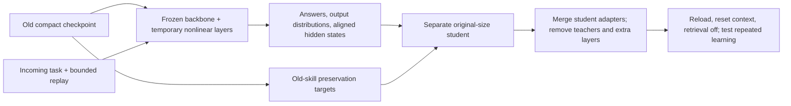

# Causal diagnosis and a route to added-layer assimilation

Status: causal diagnosis completed and audited. The subsequent added-layer screen is also completed: see [nonlinear-layer results](results/nonlinear_assimilation/screen-002/REPORT.md) and [its protocol](NONLINEAR_ASSIMILATION_STEPS.md). Single-update success does not establish continual learning.

Results: [audited report](results/causal_assimilation/diagnostic-001/REPORT.md). On fresh queries, sorting changed from 111/128 before the join update to 104/128 after it. Restoring three discovery-selected modules recovered 107/128, versus 105/128 for matched random modules; joins stayed at 64/64. Grouping remained below its earlier score. This is partial recovery and does not validate a safe knowledge-editing location. All saved variants retain 596,049,920 parameters; 16 tests and the independent audit passed.

## Question

When consolidation of join changes sorting behavior, which internal computations and parameter updates contribute to the change? Can a localized intervention improve the acquisition/retention tradeoff?

The earlier update had seven sorting regressions and five gains on 64 development examples, a net loss of two cases from its immediate predecessor. Its gate also compared against an earlier best score. A new fixed reproduction may differ because CUDA execution was not fully deterministic; do not search seeds until failure appears or describe a non-reproduction as established forgetting.

## Frozen experiment

1. Reuse the exact old grouping checkpoint, incoming join training examples, bounded replay, budgets, adapter ranks and KL settings from the rank-16 screen. Save the acquisition teacher and compact successor in a new directory; preserve earlier runs.
2. Use the previous 64 sorting development examples only for discovery. Freeze a new fingerprint-disjoint validation set: 128 sorting examples and 64 each of selection/filter/group/join. No diagnostic or validation example is supplied to training. Acquisition and student remain separate 98,304-token phases.
3. Reproduction inputs and training sources are frozen before training. The instrumentation code is frozen separately before tracing; it may be implemented while the unchanged training workers run. No adaptive changes to the learning recipe are allowed.
4. Evaluate before/after models independently. Report paired losses and gains, average accuracy, new-skill acquisition and general-probe scores. Keep both checkpoints even if the proposal fails or does not reproduce aggregate forgetting.
5. On identical teacher-forced token prefixes, sweep MLP outputs, attention outputs and residual outputs by layer. Measure raw changes in mean correct-answer token log probability; do not rely on normalized ratios when the original gap is small. Run old→new and new→old interventions. Cached activations are temporary, per batch, with a combined 512 MiB ceiling.
6. Residual replacement copies cumulative upstream information, and final residual replacement is close to an output-copy control. Such recovery does not localize knowledge storage. Do not choose residual states as editable parameter modules.
7. Complement activation patches with per-module weight reversions: independently substitute old MLP or attention weights in the successor, then restore its weights. Rank modules using all discovery sorting examples, not only selected regressions. This directly tests the contribution of changed module weights; it does not imply that a module exclusively stores sorting.
8. Select the highest-ranking weight module and top-three combination from discovery only. Compare on fresh validation against deterministic random modules matched by component family and count, plus unchanged before/after models. Save ordinary compact variants for review. Evaluate all five skills so that undoing join is visible.
9. Validate the strongest activation hypothesis with autonomous generation, using no gold answer prefixes. Compare actual old→new activation substitution with a self-patch, a fixed random-site patch, a shuffled-example donor and zero ablation. Use a fixed 32 sorting / 16 join validation subset. Report when interventions merely copy donor behavior or damage the new skill.
10. Report model size, cache bytes, GPU memory, times, complete intervention scores, paired query-level uncertainty and controls. A single learning boundary diagnoses a component; it does not establish continual learning.

## Using this for assimilation of temporary added layers

This is a proposed follow-up, not a result established by the diagnosis:

1. Add genuine temporary nonlinear residual blocks to a frozen compact backbone and train those blocks on new experience. Larger LoRA rank is a different capacity change and was already tested.
2. Ablate or bypass each temporary block to test whether it causally contributes to the acquired behavior. An active block is not automatically useful.
3. Train a separate original-size student from the old compact model. Match verified answers and teacher outputs, and selectively match intermediate representations at aligned original-layer boundaries. Temporary blocks need a declared teacher-to-student alignment; their weights cannot generally be algebraically folded into existing nonlinear layers.
4. Use diagnostic evidence to test preservation losses on old-skill computations and targeted student updates. Compare output-only distillation, representation-guided distillation and a random-site control with identical data/budgets. A selected site is a hypothesis, not a guaranteed safe editing location.
5. Remove all extra blocks, teachers and training-only alignment modules. Save/reload the original-size student, clear context and disable retrieval. Test acquisition, old-skill retention, unseen combinations and subsequent learning.

Intermediate hints have precedent in [FitNets](https://arxiv.org/abs/1412.6550); the proposed Qwen implementation still requires its own controlled test. Causal analysis follows the intervention principles and limitations discussed in [activation-patching guidance](https://arxiv.org/abs/2404.15255) and [Anthropic's circuit-tracing methods](https://transformer-circuits.pub/2025/attribution-graphs/methods.html). Suppressing an output or restoring one activation is not proof of knowledge removal.

## Concrete architecture (subsequently tested)

The following architecture was subsequently tested in the separate nonlinear-layer screen linked above. The causal diagnosis alone did not establish its effectiveness; the new run tests one acquisition/compression boundary.

Use two temporary nonlinear residual MLPs after original decoder layers 14 and 21 (zero-based). For hidden width 1,024, each computes `h + W2 SiLU(W1 RMSNorm(h))`, with bottleneck width 256, no biases, random `W1` and zero-initialized `W2`. Each has 525,312 parameters; two add 1,050,624 temporary parameters. These are additional nonlinear layers, not full transformer blocks or higher-rank LoRA. Fixed insertion locations are an initial experimental choice, not a claim that these layers store a skill.

Freeze the original backbone and train only the new layers using the incoming task, the same bounded replay, and a declared acquisition token budget. Check teacher acquisition and bypass each added layer separately and together. If acquisition fails, report it before attempting compression.

Create a separate original-size student from the old checkpoint, with rank-16 training adapters merged into the base at the end. Compare three compression arms with identical examples and token budgets:

- Output-only: verified-answer cross-entropy plus new-teacher KL on incoming examples and old-teacher KL on replay.
- Guided: the same objective plus a normalized hidden-state matching term at discovery-selected original-layer boundaries. The expanded teacher target is the state after any temporary layer at that boundary; the compact student target is its original-layer output. Match visible answer-token positions and declare coefficients before training.
- Random control: the same representation objective and number of boundaries, with locations chosen once from a fixed seed.

For replay, preservation targets come from the old compact teacher; for incoming examples, acquisition targets come from the expanded teacher. Keep teachers frozen and targets detached. This separates acquiring the new behavior from preserving previous behavior. Representation agreement is only a training signal; final autonomous behavior decides success.

Report the selected-boundary hypothesis, new-task acquisition, each old task, held-out combinations, ability to learn the next task, trainable/temporary/final parameter counts, tokens, bounded memory, peak VRAM and wall time. The main result is the compact student's behavior after removal, not expanded-teacher accuracy or similarity of hidden states. Use the same candidate acceptance gates as the earlier streams and retain a rejected candidate only as a research artifact.

The sorting location discovered here is not a default location for factual knowledge. A factual version needs its own discovery data, held-out paraphrases, related-fact locality checks and fresh causal validation. This procedural test does not establish where arbitrary facts are stored.
