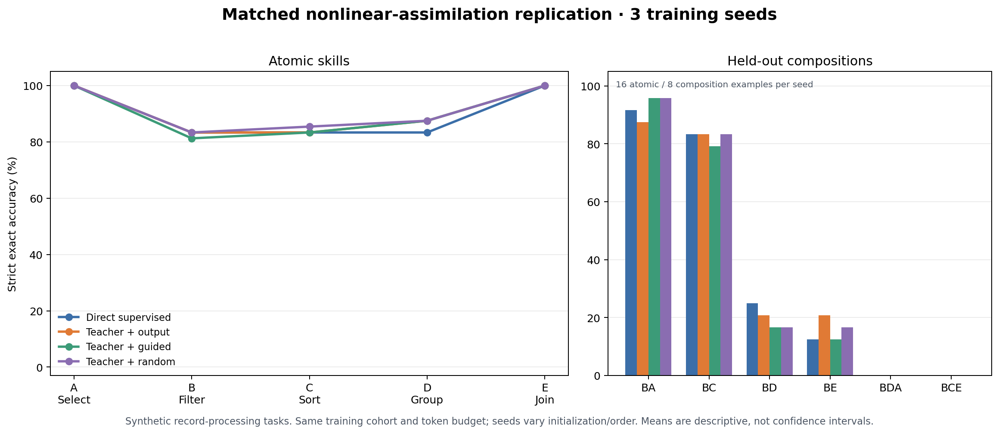
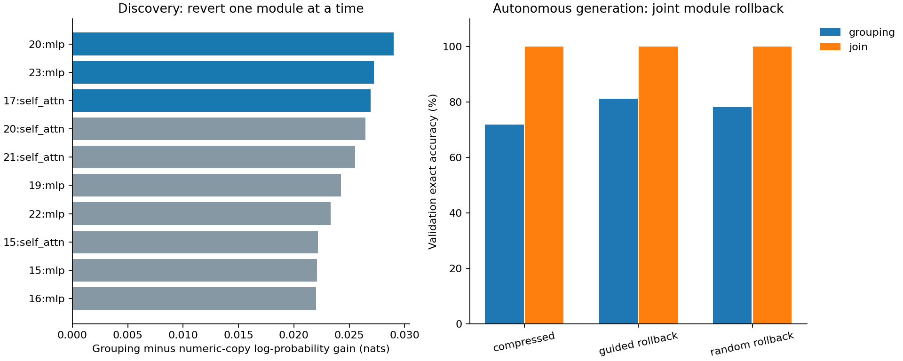
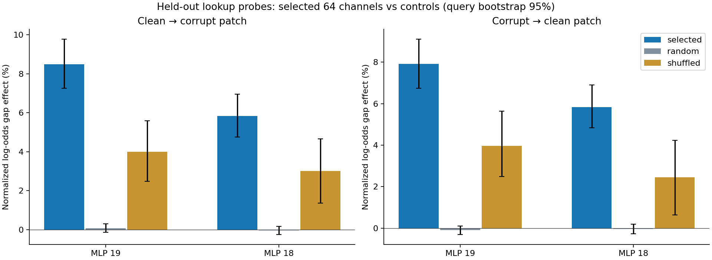
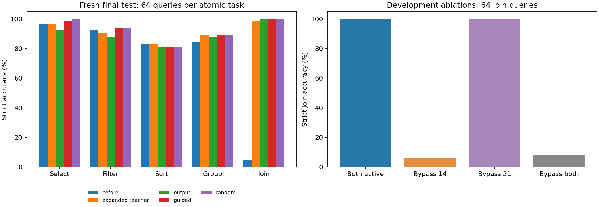

# Continual Learning Experiments

Research prototypes for adding skills to a compact language model while retaining earlier skills. The current experiments use **Qwen3-0.6B** and synthetic, executable JSON record-processing tasks. This is an experimental codebase, not a continual-learning solution: so far, no method has demonstrated reliable multi-stage learning without forgetting.

> **Current result:** In a three-seed repeat, ordinary compact supervised training learned the new join task as well as a temporary expanded teacher. Mechanistic-guided consolidation did not consistently beat random-site controls. The hardest held-out task combinations remained unsolved. These small synthetic tests do not establish broad capability retention or factual knowledge editing.

## Latest result at a glance

The latest experiment compares direct supervised updating with three students distilled from an expanded nonlinear learner. Every arm ends at the same compact model size. The chart shows average strict accuracy across three training seeds; each seed uses a small, newly generated evaluation cohort.



See the [replication report](results/nonlinear_assimilation/replication-001/REPORT.md), [machine-readable summary](results/nonlinear_assimilation/replication-001/summary.json), and [run audit](results/nonlinear_assimilation/replication-001/AUDIT.json).

## What we tried and learned

Experiments use A = select/rename, B = filter, C = sort, D = group/sum, and E = join. Task strings such as `BCE` mean applying those operations in order. `BDA` and `BCE` are used as held-out combinations in the relevant protocols.

| Experiment | Approach | Result | What it tells us |
|---|---|---|---|
| [Quick pilot](results/continual_quick/screen-001/PILOT_REPORT.md) | Fast skill-acquisition calibration and model/runtime checks | Development screen only; not a sequential continual-learning result | Useful for rejecting weak tasks and budgets before expensive runs. |
| [Five-stage assimilation](results/assimilation/experiment-001/REPORT.md) | Bounded replay, teacher/student consolidation, or composition-assisted consolidation through A→E | Methods accepted 3/5, 4/5, and 3/5 updates respectively; none accepted all five. | A good isolated update did not translate into reliable acquisition and retention across a stream. |
| [Capacity and external memory](results/capacity_memory/screen-001/REPORT.md) | Change temporary LoRA rank; test bounded retrieval memory | Rank 16 accepted D while rank 64 rejected it; at the later E boundary the arms followed different checkpoints. Frozen-base retrieval raised atomic test mean from 0% to 52.81% with retrieval enabled. | Bigger temporary adapters did not reliably solve retention. Retrieval helps when examples are supplied at inference, but that is external memory, not incorporation into weights. |
| [Causal module diagnosis](results/causal_assimilation/diagnostic-001/REPORT.md) | Trace and revert modules associated with a lost skill | Selected three-module reversion improved sorting by 1.56 points over matched random reversion; paired query-bootstrap interval was [+0.00, +3.91] points. | We found candidate update contributions, but not a dependable way to improve assimilation. |
| [Circuit-guided growth](results/circuit_growth/screen-001/growth/REPORT.md) | Localize a lookup-related MLP interface, add channels there, then compress | Related-site teacher join accuracy was 92.2%; random and fixed placement reached 100%. Compact guidance did not consistently beat direct or random controls. | A causal effect on a task is not enough to predict a useful expansion location. |
| [Grouping protection](results/group_preservation/screen-001/REPORT.md) | Use a causal trace to freeze selected modules during consolidation | Guided and random protection both scored 92.2% on grouping; neither established a reliable edge over unconstrained training. | Freezing a implicated module preserves its weights, but does not guarantee preservation of its behavior. |
| [Temporary nonlinear layers](results/nonlinear_assimilation/screen-002/REPORT.md) | Train residual nonlinear branches with a frozen backbone, then compress into the original-size model | Expanded teacher improved join from 4.69% to 98.44%; compact students reached 100% join, while harder compositions stayed weak. | Temporary capacity can acquire this narrow task, but this first screen did not show that it was needed or that interpretability improved it. |
| [Three-seed matched repeat](results/nonlinear_assimilation/replication-001/REPORT.md) | Add a direct supervised no-expanded-teacher control; compare output-only, mechanistically guided, and random-site compression | Direct and teacher-based arms all averaged 100% join. Guided and random controls were similar; BDA and BCE were 0% for every arm. | Expansion was not necessary for this task, and mechanistic guidance has not demonstrated value over controls. |

The reports contain detailed per-task scores, methods, acceptance gates, compute and study-specific caveats. The historical charts below provide some of the causal and placement evidence.

| Causal module trace | Circuit localization and placement | Initial temporary-layer screen |
|---|---|---|
|  |  |  |

## Research objective

The objective is to learn from a repeated stream while preserving prior abilities, maintaining future learnability, combining skills on unseen examples, and keeping deployed parameters, replay, and training cost bounded. A valid continual-learning claim needs to evaluate all earlier skills after every stage, test later learning against a fresh-model control, include held-out compositions, and evaluate a saved compact model after context reset. One successful update or one consolidation cycle is only a component result.

The concrete criteria and planned evaluation matrix are in [OBJECTIVES.md](OBJECTIVES.md). Protocols for prior directions are documented in [QUICK_EXPERIMENT.md](QUICK_EXPERIMENT.md), [ASSIMILATION_STEPS.md](ASSIMILATION_STEPS.md), [CAPACITY_MEMORY_STEPS.md](CAPACITY_MEMORY_STEPS.md), [CAUSAL_ASSIMILATION_STEPS.md](CAUSAL_ASSIMILATION_STEPS.md), [CIRCUIT_GUIDED_GROWTH.md](CIRCUIT_GUIDED_GROWTH.md), [GROUP_PRESERVATION_STEPS.md](GROUP_PRESERVATION_STEPS.md), and [NONLINEAR_ASSIMILATION_STEPS.md](NONLINEAR_ASSIMILATION_STEPS.md).

## Code map

- `continual/tasks.py` — deterministic task generator, JSON executor, and strict scorer.
- `continual/worker.py` — compact LoRA training and fresh-process evaluation.
- `continual/assimilation.py` — teacher-target caching and compact consolidation.
- `continual/causal_diagnosis.py`, `continual/circuit_localization.py`, `continual/circuit_growth.py` — activation tracing, intervention controls, and localized growth.
- `continual/nonlinear_layers.py` — temporary nonlinear residual branches and compact distillation.
- `continual/group_preservation.py`, `continual/external_memory.py` — module protection and bounded retrieval experiments.
- `scripts/` and `configs/` — frozen experiment runners, reports, and parameter sets.
- `tests/` — unit checks for data, training utilities, interventions, and memory bounds.
- `results/` — frozen reports, summaries, audits, charts, and run manifests. See each report for its corresponding protocol and limitations.

## Running the experiments

Training uses direct Hugging Face and PyTorch CUDA access, not Ollama. Ollama was explored as a local inference option; it is not the experiment-training backend. The pinned starting model revision and local setup notes are in [LOCAL_QWEN.md](LOCAL_QWEN.md). The current scripts expect a local training environment at `.runtime/train-env` and the required model checkpoint files to be available locally.

Examples (run from the repository root):

```sh
# Run unit checks
.runtime/train-env/bin/python -m unittest discover -s tests -v

# Reproduce or resume a frozen experiment in its existing output directory
.runtime/train-env/bin/python scripts/continual_quick.py all
.runtime/train-env/bin/python scripts/assimilation_run.py
.runtime/train-env/bin/python scripts/capacity_memory_run.py
.runtime/train-env/bin/python scripts/causal_assimilation_run.py
.runtime/train-env/bin/python scripts/circuit_growth_run.py
.runtime/train-env/bin/python scripts/group_preservation_run.py
.runtime/train-env/bin/python scripts/nonlinear_assimilation_run.py \
  --output results/nonlinear_assimilation/screen-002

# Rebuild the small three-seed repeat summary/plot after its runs are present
.runtime/train-env/bin/python scripts/nonlinear_assimilation_replicate.py \
  --seeds 43 44 45
```

Check each protocol before running. Some scripts default to a new or earlier run path, and several experiments require checkpoints produced by previous runs. The frozen per-run config takes precedence when resuming; do not overwrite old run directories to try a new configuration. Start a new output directory for a new experiment and freeze its config and data first.

## Scope and data

The record-processing benchmark has exact executable answers and makes small controlled tests cheap. It is not an open-domain factual knowledge benchmark, and success does not show that a model can edit arbitrary facts or retain all natural-language capabilities. Current results are mostly one boundary or one task order; the latest repeated screen varies training seeds but keeps its training cohort fixed. Test cohorts are small in the three-seed repeat.

No trained model weights, downloaded checkpoints, large generated prompt corpora, or activation dumps are tracked in Git. Checkpoints and temporary tensors are excluded by `.gitignore`; supply the local model weights and regenerate the frozen data to reproduce training. Compact reports, machine-readable summaries, audits, hashes, and plots are retained so the main findings can be inspected without pushing those large artifacts.

## Most useful next experiment

Move from another one-boundary architecture search to a repeated, multi-stage stream with multiple task orders and enough fresh examples to estimate retention. Include direct supervised updates, bounded replay, temporary expansion plus consolidation, and the best candidate mechanism under matched data and compute. Track prior-skill retention and unseen compositions at every stage, then test whether late-stage learning remains as effective as learning from a fresh model. Interpretability should stay in the comparison only if its guided arm reliably beats capacity-matched random and direct controls.
