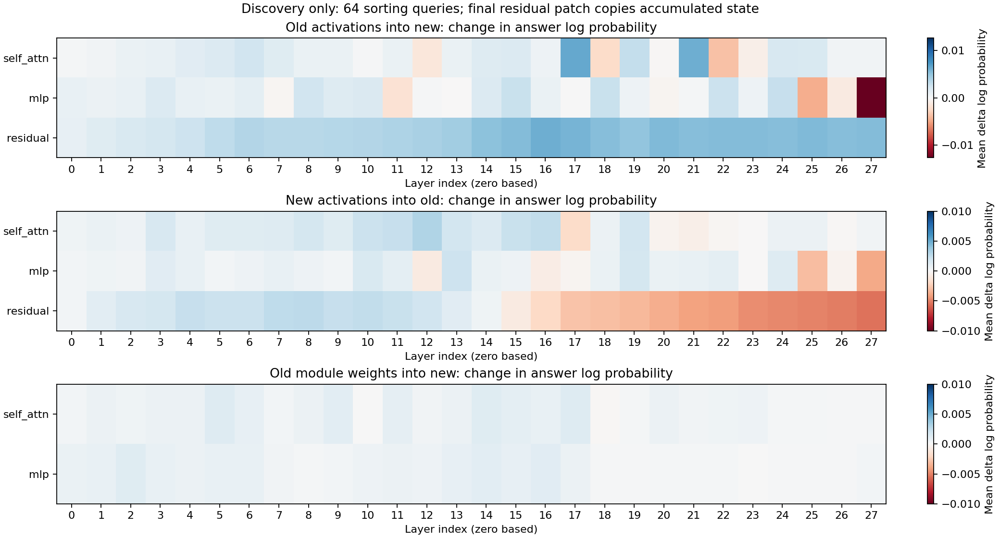

# Causal diagnosis of one join update

Completed with Hugging Face/PyTorch on CUDA, using direct checkpoint access for internal hooks rather than the Ollama API. This is a component diagnosis, not a continual-learning or added-layer assimilation result. The tasks are synthetic JSON table operations; this does not demonstrate locating or deleting factual world knowledge.

## Main finding

The selected three-module reversion changed sorting from 81.25% to 83.59%, versus 82.03% for matched random reversion. The selected-minus-random difference was +1.56 pp (paired query bootstrap 95% [+0.00, +3.91] pp). The original model scored 86.72% on sorting. Grouping after selected reversion was 70.31%, compared with 79.69% before learning join. This is partial recovery, not restoration of prior skills or a validated safe editing location. The activation intervention improved sorting by one of 32 cases while losing one of 16 joins; the single selected weight reversion did not reproduce that improvement.

## Reproduction and fresh validation

Discovery sorting changed with 9 losses and 6 gains out of 64. The learning recipe and inputs were fixed; there was no seed search. Discovery is the old development set; the five atomic-task columns below use fresh fingerprint-disjoint queries. General MC uses the fixed legacy 32-question probe, not a new held-out general-capability benchmark.

| Saved model | Select /64 | Filter /64 | Sort /128 | Group /64 | Join /64 | General MC /32 |
|---|---:|---:|---:|---:|---:|---:|
| before | 100.00% | 84.38% | 86.72% | 79.69% | 6.25% | 75.00% |
| after | 100.00% | 85.94% | 81.25% | 68.75% | 100.00% | 75.00% |
| top1 | 100.00% | 85.94% | 80.47% | 70.31% | 100.00% | 75.00% |
| random1 | 100.00% | 85.94% | 82.03% | 68.75% | 100.00% | 75.00% |
| top3 | 100.00% | 85.94% | 83.59% | 70.31% | 100.00% | 75.00% |
| random3 | 100.00% | 85.94% | 82.03% | 68.75% | 100.00% | 75.00% |

All variants are ordinary reloaded compact models with 596,049,920 parameters and retrieval off. Variant names refer to sorting discovery scores, not validation winners. No variant is automatically accepted.

## Discovery-selected interventions

Activation hypothesis: `17:self_attn`. Random activation control: `7:self_attn`. Module indices are zero based. The ranking uses all 64 sorting queries and raw mean answer-token log probability changes.

| Variant | Old modules restored | Fresh sorting difference vs after | Query bootstrap 95% | Fresh join difference |
|---|---|---:|---|---:|
| top1 | 17:self_attn | -0.78 pp | [-2.34, +0.00] pp | +0.00 pp |
| random1 | 22:self_attn | +0.78 pp | [+0.00, +2.34] pp | +0.00 pp |
| top3 | 17:self_attn, 5:self_attn, 2:mlp | +2.34 pp | [+0.00, +5.47] pp | +0.00 pp |
| random3 | 23:self_attn, 21:self_attn, 9:mlp | +0.78 pp | [+0.00, +2.34] pp | +0.00 pp |

These intervals resample queries, not training seeds; they do not correct discovery ranking for multiple comparisons. Independent validation and matched random controls are the primary checks.

## Autonomous activation validation

| Condition | Sorting /32 | Join /16 |
|---|---:|---:|
| before | 84.38% | 6.25% |
| after | 87.50% | 100.00% |
| old_patch | 90.62% | 93.75% |
| self_patch | 87.50% | 100.00% |
| random_patch | 87.50% | 100.00% |
| shuffled_patch | 31.25% | 68.75% |
| zero_ablation | 53.12% | 93.75% |
| output_copy_control | 84.38% | 6.25% |

No gold answers or prefixes enter autonomous generation. The donor sees the same generated prefix as the recipient. The self-patch must reproduce the recipient; final residual replacement must reproduce the donor. The latter is an output-copy control and does not locate knowledge. Shuffled donor activations can be off distribution. Activation-patched inference requires the donor model at runtime; it is a diagnostic, not assimilated memory. Only the separately reloaded weight variants run without that donor.

## Interpretation and added layers

Activation recovery shows a causal dependency under a specific intervention. Weight reversion tests changed module parameters. Neither identifies an exclusive address for a fact, proves erasure, or guarantees a safe edit. This study uses broad modules rather than Anthropic-style sparse feature circuits. Cross-model activations may be misaligned.

For actual temporary nonlinear blocks, use these measurements to choose hypotheses for representation distillation and preservation losses. Compare output-only compression, representation-guided compression and matched random-site compression with the same budget. Ablate the added blocks to establish useful contribution, then remove the blocks and all teachers before evaluating the saved compact student. Repeat learning boundaries and test acquisition, retention, transfer and sustained learnability. This run trained LoRA acquisition/consolidation; it did not train or assimilate added nonlinear blocks.

See [the frozen protocol](../../../CAUSAL_ASSIMILATION_STEPS.md) for the follow-up. Intermediate-representation distillation has precedent in [FitNets](https://arxiv.org/abs/1412.6550); causal interpretation follows [activation-patching guidance](https://arxiv.org/abs/2404.15255) and [Anthropic’s methods](https://transformer-circuits.pub/2025/attribution-graphs/methods.html).

## Resources and audit

```json
{
  "trace_wall_seconds": 815.1417956640071,
  "peak_cuda_allocated_bytes": 2812763648,
  "before_parameters": 596049920,
  "after_parameters": 596049920,
  "peak_activation_cache_bytes": 273874944,
  "cuda_device": "NVIDIA GeForce RTX 3060 Laptop GPU",
  "total_wall_seconds": 1146.896250376005
}
```

The audit rechecks source/input/checkpoint hashes, all generated-answer scores, held-out fingerprints, target execution, site selection, every tensor of all four reversion checkpoints, parameter counts, cache bounds and copy controls. Full audit: `AUDIT.json`; per-query effects: `trace.json`; selection: `selection.json`; paired uncertainties: `summary.json`. Acquisition and consolidation token counts are in their respective `training.json` files. Retained before/after/teacher/variant checkpoints are research audit artifacts, not a bounded online memory mechanism.


