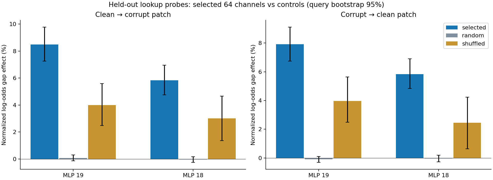
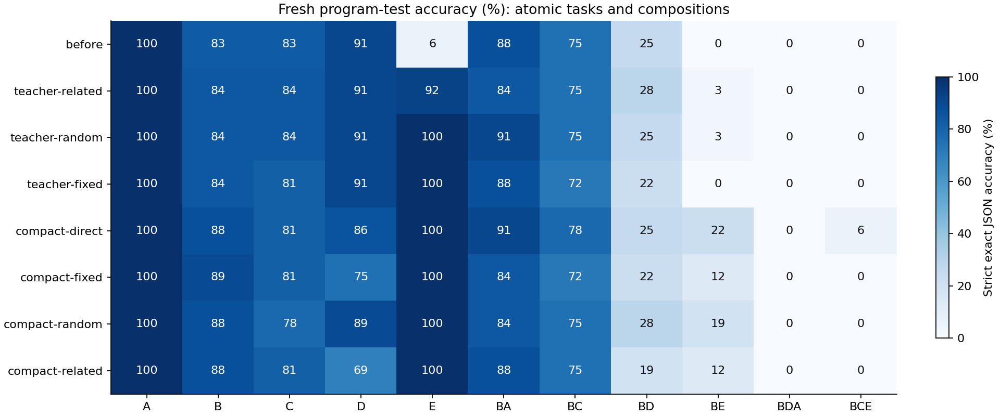

# Causal lookup localization and native-channel growth

Both selected MLP interfaces passed causal lookup validation, but guided growth did not outperform both placement controls. Teacher join test accuracy: related 92.2%, random 100.0%, fixed 100.0%. The guided compact learner returned to the original parameter count, with join 100.0% versus direct 100.0%. Its grouping test accuracy was 68.8% versus before 90.6% and direct 85.9%; its development retention decision was rejected. Causal contribution of an existing primitive did not by itself establish a superior place to assimilate a new skill. No repeated continual-learning claim follows.

One predeclared D-to-E boundary on Qwen3-0.6B, one training seed. Final program-task test prompts were held apart from discovery, causal validation, training and development selection. Fixed general diagnostics are reused. No model was automatically deployed.

## What was localized

Discovery selected zero-based MLPs [19, 18]. Lookup passed the primitive capability prerequisite; equality did not. Both sites passed all held-out tests in both patch directions: positive related effect and specificity versus copying/constant controls, plus superiority of selected 64 channels over same-layer random channels and shuffled donors. Full-module effects were also positive and specific.

The intervention is at the final prompt position. Its endpoint gradient attribution and native-channel patches provide evidence about a lookup-related readout path. They do not identify a complete join circuit, uniquely semantic neurons, a safe editable knowledge address, or all relevant attention routing. No sparse autoencoder/transcoder was trained. Attention heads were screened and patched separately; their query-level results are in summary.json. Zero ablation is diagnostic and was not used to rerank candidates.

## Matched placement and direct controls

Placement arms: {"related":[19,18],"random":[15,12],"fixed":[14,21]}. Every expanded teacher adds 64 native gated MLP channels at each of two sites: 393,216 new trainable parameters, 596,443,136 total. All old weights remain frozen, with matching before/after digests. The new down projections start at zero. The bank is mathematically equivalent to widening the gated MLP, with separately registered weights. New inputs are randomly initialized; selected old channel indices are evidence for the interface, not an initialization or neuron-neighborhood rule.

Each successful teacher is compressed using the same output-only method into a separate rank-16 LoRA student, then merged, saved and evaluated in a fresh process at exactly 596,049,920 parameters without added banks or retrieval. Each compact learner trains 10,092,544 adapter parameters. The direct control receives identical verified examples, schedule and old-teacher preservation targets, but no expanded-teacher new-task targets. Each teacher and each compact learner consumes the same token budget separately; temporary growth therefore costs an additional training phase and teacher target caching.

## Untouched final tests

A = select/rename; B = filter; C = sort; D = group/sum; E = join. Letters compose left to right. Atomic tasks have 64 examples each; each composition has 32. Strict correctness requires exact executable JSON output.

| Model | A | B | C | D | E | BA | BC | BD | BE | BDA | BCE | General MC |
|---|---:|---:|---:|---:|---:|---:|---:|---:|---:|---:|---:|---:|
| before | 100.0 | 82.8 | 82.8 | 90.6 | 6.2 | 87.5 | 75.0 | 25.0 | 0.0 | 0.0 | 0.0 | 75.0 |
| teacher-related | 100.0 | 84.4 | 84.4 | 90.6 | 92.2 | 84.4 | 75.0 | 28.1 | 3.1 | 0.0 | 0.0 | 75.0 |
| teacher-random | 100.0 | 84.4 | 84.4 | 90.6 | 100.0 | 90.6 | 75.0 | 25.0 | 3.1 | 0.0 | 0.0 | 75.0 |
| teacher-fixed | 100.0 | 84.4 | 81.2 | 90.6 | 100.0 | 87.5 | 71.9 | 21.9 | 0.0 | 0.0 | 0.0 | 75.0 |
| compact-direct | 100.0 | 87.5 | 81.2 | 85.9 | 100.0 | 90.6 | 78.1 | 25.0 | 21.9 | 0.0 | 6.2 | 75.0 |
| compact-fixed | 100.0 | 89.1 | 81.2 | 75.0 | 100.0 | 84.4 | 71.9 | 21.9 | 12.5 | 0.0 | 0.0 | 75.0 |
| compact-random | 100.0 | 87.5 | 78.1 | 89.1 | 100.0 | 84.4 | 75.0 | 28.1 | 18.8 | 0.0 | 0.0 | 75.0 |
| compact-related | 100.0 | 87.5 | 81.2 | 68.8 | 100.0 | 87.5 | 75.0 | 18.8 | 12.5 | 0.0 | 0.0 | 75.0 |

## Development-only acceptance

Acquisition requires E ≥75%; old-task and old-composition degradation must be ≤5 percentage points, with the fixed general MC probe also within 5 points. References for A/B/C/BA/BC are the better of the before-D checkpoint and historical-C checkpoint on the same development cohort; D/BD/BDA use the before-D checkpoint. The old model already has weak composition performance; retention is measured against that existing behavior, not a claim of strong composition capability.

- direct: rejected: C exceeds retention tolerance
- related: rejected: C exceeds retention tolerance, BA exceeds retention tolerance, D exceeds retention tolerance, BD exceeds retention tolerance
- random: rejected: C exceeds retention tolerance, BA exceeds retention tolerance, D exceeds retention tolerance
- fixed: rejected: C exceeds retention tolerance, BA exceeds retention tolerance, D exceeds retention tolerance

In the guided compact learner, 20 grouping failures preserved the correct group keys and output shape but produced wrong totals. Saved counterexamples and exact diagnostic counts for every arm are in summary.json. These are behavioral error categories, not an identified internal cause.

All candidates remain research artifacts, including rejected models. Test results do not change the predeclared development decision. The historical sorting gate can reject a learner that inherits an existing deficit: compare before-D and learner scores before calling a rejection new forgetting.

## Added-bank causal controls

| Placement | Full teacher dev E | Bypass first site | Bypass second site | Bypass both |
|---|---:|---:|---:|---:|
| related | 100.0 | 93.8 | 0.0 | 12.5 |
| random | 100.0 | 96.9 | 28.1 | 12.5 |
| fixed | 100.0 | 12.5 | 96.9 | 12.5 |

These bypasses change only the added banks. Both-bank bypass reproduces original responses exactly; individual bypasses test contribution of each learned bank without identifying unique skill storage.

## Evidence, cost and limits

Each phase used 98,189 actual input tokens against a 98,304 ceiling. Replay is bounded to 115 examples / 15,762 tokenizer tokens. Localization used 224 counterfactual pairs; development has 289 prompts and final test has 513, including one reused general generation prompt. The 32-item fixed general MC diagnostic is narrow and reused, not a general benchmark. Target caches have a combined 16 MiB ceiling and are deleted after training. See AUDIT.json for observed bytes and token limits, and summary.json for per-phase resources and paired comparisons.

Every teacher has separate first-bank, second-bank and both-bank bypass tests. Both-bank bypass must reproduce all 32 original development E responses exactly. Each compact checkpoint is independently counted and reloaded. Saved outputs are rescored; sources, examples, schedule, selection and original backbone are hash checked.

The original model reached the shared 192-token generation cap on three filter-join and two filter-sort-join test prompts; trained candidates had no test cap hits. The longest gold test/development answer is 55 tokens. The common generation cap was not changed after seeing results.

Paired bootstrap intervals in summary.json quantify variation over this small query cohort only. They do not measure variation over training seeds, task orders or localization choices; comparisons are exploratory and not corrected for multiplicity. New-task teacher targets are enabled only when teacher argmax matches every gold answer token under teacher forcing, as in the existing compression recipe; verified-answer cross entropy is still supplied to every compact learner.

A placement advantage must appear against both random and fixed placement. A temporary-teacher benefit must appear against the direct compact learner after accounting for extra training compute. Successful acquisition or compact export alone is insufficient: repeated task streams must preserve old atomics and compositions and sustain later learning under bounded resources. This experiment cannot establish continual learning or safe deletion of knowledge.

Artifacts: [audit](AUDIT.json), [summary](summary.json), [frozen growth manifest](frozen-growth.json), [localization audit](../LOCALIZATION_AUDIT.json), [protocol](../../../../CIRCUIT_GUIDED_GROWTH.md).
