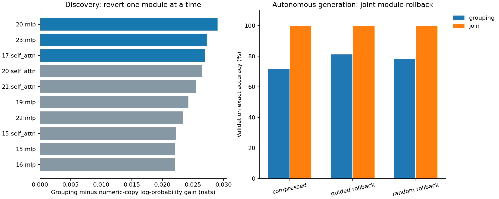
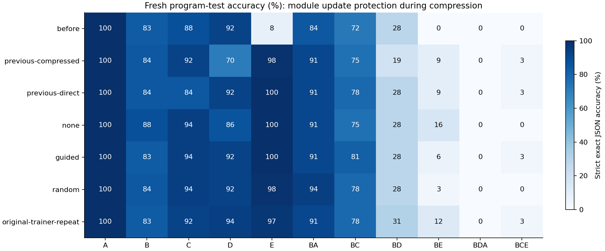

# Grouping trace and update protection

The module-level grouping update contribution passed held-out causal validation. Test grouping: before 92.2%, unconstrained 85.9%, guided protection 92.2%, random protection 92.2%. Test join: unconstrained 100.0%, guided 100.0%, random 98.4%. Exact local weight preservation is verified; all retention and composition scores still determine whether this is useful assimilation. Current-checkpoint development gates passed: ['random']; historical-best gates passed: none. Causal guidance did not beat matched random protection on grouping accuracy. Fixed-input unconstrained repeats scored 55-60/64 grouping; the guided score falls within that observed range. The original-trainer verification repeat also passed the current-checkpoint gate. Audit status: passed with a reproducibility limit. The data do not establish a reliable benefit from guided module protection.

## Fixed hypothesis and scope

Trace the old grouping computation lost during compression, then prevent updates in the implicated modules during a fresh compression run. This is one predeclared D-to-E boundary and one seed. All previous experiments and frozen source files remain intact. No candidate is deployed.

Discovery selected ['20:mlp', '23:mlp', '17:self_attn']; same-component random controls are ['10:mlp', '2:mlp', '24:self_attn']. Both sets contain three disjoint modules. The intervention granularity is an entire attention or MLP module, not individual semantic neurons. The trace does not uniquely locate arithmetic knowledge.

Discovery has 32 grouping and 16 select/rename copying prompts. Score only prediction positions for total-number tokens in grouping and numeric values in the copying control. Gold answers are used for teacher-forced tracing, including aligned activation patches, reverse patches and exact module weight rollback. Rank by grouping-minus-copying rollback gain. Freeze selection before validation; no reranking, seed search or hyperparameter tuning.

Validation has 32 grouping, 16 copying and 16 join prompts. Positive grouping numeric gain and specificity confidence bounds plus improved exact grouping generation validate a grouping-related update contribution. Autonomous donor patching uses recipient-generated prefixes, never gold continuations. Random-module, shuffled-donor, zero-ablation, self-patch and final-output-copy controls are recorded. Failed localization is reported without a circuit claim; the predeclared protection ablations still run.

## Protection test

All three learners start from the same pre-join checkpoint and use the identical 98,189-input-token schedule, verified answers, bounded old replay, old-target KL and the same frozen expanded teacher for new-task targets. Only adapter eligibility changes. Guided and random arms have equal trainable capacity; unconstrained has more. No added parameters remain after adapter merging. Freezing a module preserves its local weights exactly but cannot guarantee unchanged activations, because its inputs can change upstream.

| Learner | Trainable parameters | Protected adapter parameters |
|---|---:|---:|
| none | 10,092,544 | 0 |
| guided | 9,535,488 | 557,056 |
| random | 9,535,488 | 557,056 |

## Fresh final tests

A select/rename, B filter, C sort, D grouping/sum, E join. Operations compose left to right. Atomic tasks have 64 examples and compositions 32. Fixed general probes are reused and are narrow diagnostics.

| Model | A | B | C | D | E | BA | BC | BD | BE | BDA | BCE | General MC |
|---|---:|---:|---:|---:|---:|---:|---:|---:|---:|---:|---:|---:|
| before | 100.0 | 82.8 | 87.5 | 92.2 | 7.8 | 84.4 | 71.9 | 28.1 | 0.0 | 0.0 | 0.0 | 75.0 |
| previous-compressed | 100.0 | 84.4 | 92.2 | 70.3 | 98.4 | 90.6 | 75.0 | 18.8 | 9.4 | 0.0 | 3.1 | 75.0 |
| previous-direct | 100.0 | 84.4 | 84.4 | 92.2 | 100.0 | 90.6 | 78.1 | 28.1 | 9.4 | 0.0 | 3.1 | 75.0 |
| none | 100.0 | 87.5 | 93.8 | 85.9 | 100.0 | 90.6 | 75.0 | 28.1 | 15.6 | 0.0 | 0.0 | 75.0 |
| guided | 100.0 | 82.8 | 93.8 | 92.2 | 100.0 | 90.6 | 81.2 | 28.1 | 6.2 | 0.0 | 3.1 | 75.0 |
| random | 100.0 | 84.4 | 93.8 | 92.2 | 98.4 | 93.8 | 78.1 | 28.1 | 3.1 | 0.0 | 0.0 | 75.0 |
| original-trainer-repeat | 100.0 | 82.8 | 92.2 | 93.8 | 96.9 | 90.6 | 78.1 | 31.2 | 12.5 | 0.0 | 3.1 | 75.0 |

The fresh unconstrained run did not reproduce the older failed checkpoint bit for bit. The failed exact-reproduction check is retained in the audit. Protection is compared against the fresh unconstrained run, not assumed-identical older results. A separately planned repeat uses the original trainer entrypoint and identical cached targets, and initialization fingerprints compare both entrypoints. Deterministic training algorithms were not enabled. The original-trainer repeat is a reproducibility control, never an extra candidate for selecting a favorable result. Previous direct learning uses no new-task teacher targets and is evaluated on the same fresh cohorts.

## Development decisions

Join must reach 75%, every old atomic task and old composition must stay within 5 percentage points, and the fixed general MC diagnostic must stay within 5 points. The current-checkpoint gate measures newly introduced forgetting. The historical-best gate separately asks whether inherited deficits have also been recovered. Test data never change these decisions.

- none, current_checkpoint: rejected: BD exceeds retention tolerance
- none, historical_best: rejected: C exceeds retention tolerance, BC exceeds retention tolerance, BD exceeds retention tolerance
- guided, current_checkpoint: rejected: BD exceeds retention tolerance
- guided, historical_best: rejected: C exceeds retention tolerance, BC exceeds retention tolerance, BD exceeds retention tolerance
- random, current_checkpoint: accepted
- random, historical_best: rejected: C exceeds retention tolerance, BC exceeds retention tolerance

The same gates applied to the previous direct-learning reference:
- previous-direct, current_checkpoint: rejected: BD exceeds retention tolerance
- previous-direct, historical_best: rejected: C exceeds retention tolerance, BD exceeds retention tolerance
- original-trainer-repeat, current_checkpoint: accepted
- original-trainer-repeat, historical_best: rejected: C exceeds retention tolerance, BC exceeds retention tolerance

## Evidence and limits

All final compact checkpoints reload in fresh processes at 596,049,920 parameters without a teacher, retrieval or extra modules. Frozen source/input/checkpoint manifests, exact protected-module hashes, executable answer checks, rescored outputs, paired query differences, development gates, cache bytes, training tokens and CUDA resources are recorded in AUDIT.json and summary.json.

The learner has 115 replay examples / 15,762 tokenizer tokens. Combined old/new target caches must remain within 16 MiB and are deleted after the runs. Tracing has a separate 256 MiB CPU activation-cache ceiling and measured CUDA memory. The old and failed compact models and expanded teacher are research/training dependencies, not inference dependencies; historical teacher-acquisition compute must be added when considering end-to-end cost.

This is a retrospective two-pass procedure: module selection inspects a previous failed update before retraining from the original checkpoint. It also uses 48 additional labeled old-task discovery prompts outside the optimizer replay, followed by 48 old-task and 16 join validation prompts. These diagnostic budgets are fixed and recorded but are additional old-task information. A successful result would not yet establish an online method within a replay-only information budget; that requires tracing from bounded retained memory or accounting for probe-update/rollback cost, plus a diagnostic-data-matched replay control.

Query-bootstrap intervals quantify uncertainty over these prompts only, not over training seeds, task orders or module selection; comparisons are exploratory and uncorrected for multiplicity. Teacher-forced likelihood recovery alone is not autonomous repair. Weight rollback and retraining with weights protected are separate interventions. A local benefit can coexist with loss elsewhere; report all old tasks and compositions. Successful acquisition, compression or exact weight preservation alone does not establish continual learning.

Accumulating protected modules over further stages can reduce the capacity left for learning; sustained plasticity requires additional task boundaries and orders. The causal cached decoder is separately checked against model.generate on real examples from both frozen checkpoints.

Artifacts: [audit](AUDIT.json), [summary](summary.json), [frozen manifest](frozen.json), [validation decision](validation-decision.json), [protocol](../../../GROUP_PRESERVATION_STEPS.md).
