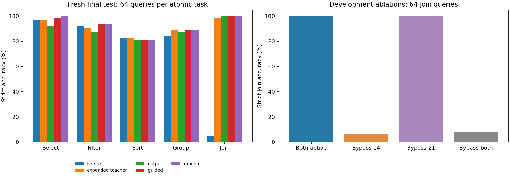

# Temporary nonlinear-layer screen

Completed on the RTX 3060 Laptop GPU with direct Hugging Face/PyTorch CUDA access. The original backbone was frozen during expanded-teacher acquisition; two actual nonlinear residual branches were trained.

## Main finding

Temporary branches raised fresh join accuracy from 4.69% to 98.44% while the backbone weights stayed unchanged. Development join successes were 4/64 with branch 14 bypassed, and 64/64 with branch 21 bypassed. 2/3 compact students passed all frozen development acquisition/retention gates. Final compact join accuracies were output: 100.00%, guided: 100.00%, random: 100.00%. The compact models have no added branches or teacher at evaluation. The expanded teacher solved only 3/32 filter-join and 0/32 filter-sort-join queries; isolated acquisition did not establish compositional transfer.

## Acquisition and ablations

The expanded teacher passed the frozen development acquisition gate (join 100.00%, required ≥75% and ≥10 pp gain). The branch weights contain 1,050,624 parameters; the expanded model contains 597,100,544. The backbone tensor digest was unchanged by training.

| Development ablation | Sorting /32 | Grouping /32 | Join /64 |
|---|---:|---:|---:|
| both active | 87.50% | 96.88% | 100.00% |
| bypass-14 | 87.50% | 93.75% | 6.25% |
| bypass-21 | 87.50% | 100.00% | 100.00% |
| bypass-both | 90.62% | 93.75% | 7.81% |

Bypassing both branches exactly reproduced all 128 original-model responses. Individual bypass effects are causal interventions on this model, not unique knowledge addresses.

## Fresh final test

| Model | Select /64 | Filter /64 | Sort /64 | Group /64 | Join /64 | Fixed general MC /32 |
|---|---:|---:|---:|---:|---:|---:|
| before | 96.88% | 92.19% | 82.81% | 84.38% | 4.69% | 75.00% |
| expanded teacher | 96.88% | 90.62% | 82.81% | 89.06% | 98.44% | 75.00% |
| output | 92.19% | 87.50% | 81.25% | 87.50% | 100.00% | 75.00% |
| guided | 98.44% | 93.75% | 81.25% | 89.06% | 100.00% | 75.00% |
| random | 100.00% | 93.75% | 81.25% | 89.06% | 100.00% | 75.00% |

Atomic and composition test prompts are fingerprint-disjoint from current training, historical archives, prior diagnosis and development prompts. The general MC probe is fixed and reused; it is not a fresh general-capability benchmark.

## Compact compression and acceptance

Every compact student was exported and reloaded in a fresh ordinary evaluation process with retrieval off. Each contains 596,049,920 parameters, with no temporary layers, teacher, training adapter or previous context.

| Arm | Development accepted | Rejection reasons |
|---|---|---|
| output | True | None |
| guided | False | C exceeds historical retention tolerance |
| random | True | None |

Acceptance uses only development data, with historical accepted checkpoints re-evaluated on that same cohort. All three arms share the same frozen sampling schedule, token budget, replay and output targets. Guided matches decoder-boundary states at layers 2/5/17; random matches 9/21/23 with the same coefficient. The earlier diagnostic selected broad modules with weak validation; these hidden boundaries are hypotheses, not established safe locations.

| Fresh test difference | Sort | Group | Join |
|---|---|---|---|
| Guided minus output | +0.00 pp [-10.94, +10.94] | +1.56 pp [-6.25, +9.38] | +0.00 pp [+0.00, +0.00] |
| Guided minus random | +0.00 pp [-9.38, +10.94] | +0.00 pp [-6.25, +6.25] | +0.00 pp [+0.00, +0.00] |

Brackets are paired query-bootstrap 95% intervals. They do not cover training seeds or correct for multiple task comparisons. Final test does not choose an arm, site or coefficient. No candidate is deployed automatically.

## Composition transfer

| Model | BA /32 | BC /32 | BD /32 | BE /32 | BDA /32 | BCE /32 |
|---|---:|---:|---:|---:|---:|---:|
| before | 84.38% | 68.75% | 37.50% | 0.00% | 0.00% | 0.00% |
| expanded teacher | 84.38% | 65.62% | 37.50% | 9.38% | 0.00% | 0.00% |
| output | 84.38% | 68.75% | 31.25% | 12.50% | 0.00% | 0.00% |
| guided | 84.38% | 65.62% | 31.25% | 12.50% | 0.00% | 0.00% |
| random | 84.38% | 62.50% | 12.50% | 12.50% | 0.00% | 0.00% |

This boundary receives no composition training. The old backbone has previously seen BA/BC; incoming-join combinations BE/BCE test new transfer. The development acceptance gate covers atomic skills, not composition retention. In particular, the random-location student passed that gate while filter-group test accuracy fell from 12/32 to 4/32; output/guided scored 10/32. Passing the atomic gate therefore does not establish broad retention.

## Cost and validation

| Training phase | Trainable parameters | Input tokens | Training seconds | Peak allocated VRAM GiB |
|---|---:|---:|---:|---:|
| teacher | 1,050,624 | 98,189 | 72.1 | 2.24 |
| output | 10,092,544 | 98,189 | 127.8 | 2.38 |
| guided | 10,092,544 | 98,189 | 119.9 | 2.38 |
| random | 10,092,544 | 98,189 | 123.7 | 2.38 |

Combined target cache: 161,059,352 bytes (ceiling 536,870,912); tensor caches deleted after the run. All three compression arms receive the same union cache; output-only ignores its hidden states. A minimal output-only cache could omit those states, but that storage optimization is not measured here. Representation losses add training compute at the same token budget. Retained model checkpoints are research audit artifacts, not bounded online memory.

The expanded teacher receives replay during acquisition; the earlier LoRA teacher received new examples alone. Across-run teacher comparisons therefore do not isolate architecture. Within-run compression arms use the same teachers and samples.

`AUDIT.json` checks source/input/backbone hashes, target execution, held-out fingerprints, every response score, unchanged-backbone digests, ablations, parameter counts, compact tensor names, identical training schedules, cache bounds and development-only decisions. Unit tests and CUDA smoke evidence are in `verification.json`.

The first launch in `screen-001` failed in status-path JSON logging before teacher training. It was preserved; `screen-002` uses the same scientific inputs with logging serialization fixed.

## Limits and next decision

This is one synthetic procedural boundary, one seed and one insertion/bottleneck choice. It does not establish factual-knowledge assimilation, universal retention or sustained ability to learn subsequent tasks. Every compact student also receives verified new-task answers directly. A successful student therefore does not establish that temporary-teacher targets were necessary or better than ordinary supervised learning; a matched no-expanded-teacher control is required for that claim. If the teacher succeeds but compact students lose skills, compression is the remaining bottleneck. If guided does not reliably beat output-only and random controls, do not assume causal localization improves assimilation. A promising candidate must next survive repeated learning boundaries, later-task acquisition, held-out compositions and bounded-resource accounting.

Protocol: [NONLINEAR_ASSIMILATION_STEPS.md](../../../NONLINEAR_ASSIMILATION_STEPS.md).

